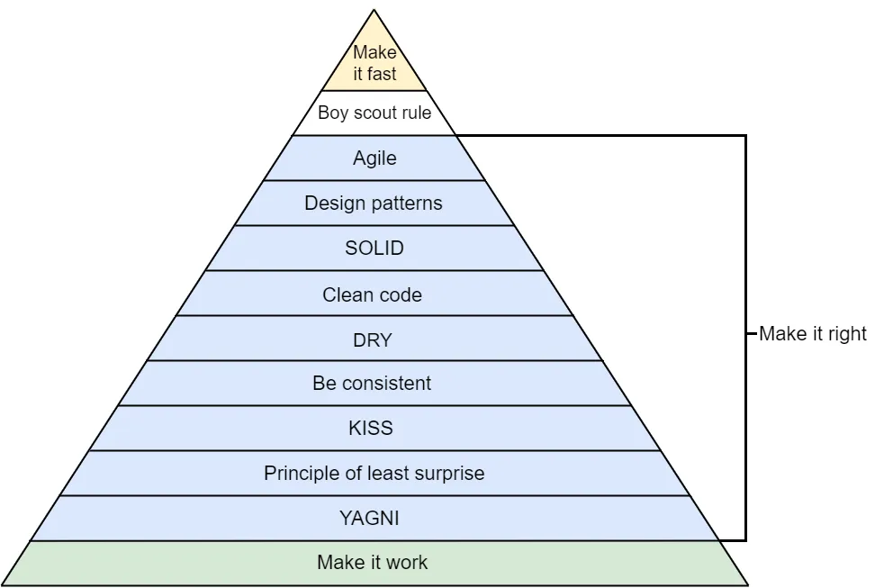

### Architecture Pattern

* [UI Pattern Folder](/2%20ComputerScience/2.4%20Architecture/2.4.1%20PatternsAndPrinciple/2.4.1.2%20ArchitecturePattern/2.4.1.2.2%20UIPattern/)
    * [MVC](/2%20ComputerScience/2.4%20Architecture/2.4.1%20PatternsAndPrinciple/2.4.1.2%20ArchitecturePattern/2.4.1.2.2%20UIPattern/MVC.md)
    * [MVVM](/2%20ComputerScience/2.4%20Architecture/2.4.1%20PatternsAndPrinciple/2.4.1.2%20ArchitecturePattern/2.4.1.2.2%20UIPattern/MVVM.md)
    * [VIP](/2%20ComputerScience/2.4%20Architecture/2.4.1%20PatternsAndPrinciple/2.4.1.2%20ArchitecturePattern/2.4.1.2.2%20UIPattern/VIP.md)
    * [VIPER](/2%20ComputerScience/2.4%20Architecture/2.4.1%20PatternsAndPrinciple/2.4.1.2%20ArchitecturePattern/2.4.1.2.2%20UIPattern/VIPER.md)
* [Clean Architecure](/2%20ComputerScience/2.4%20Architecture/2.4.1%20PatternsAndPrinciple/2.4.1.2%20ArchitecturePattern/2.4.1.2.1%20CleanArchitecture.md)

### Design Pattern

Как изучать?

1. - [x] [Computer Science Шаблоны Проектирования](https://www.youtube.com/watch?v=7tXC5ReNRAQ&t=216s&ab_channel=Winderton)
2. - [x] [Design-Patterns-In-Swift](https://github.com/ochococo/Design-Patterns-In-Swift)
3. - [x] [Шпаргалка](https://habr.com/ru/articles/210288/)

"[Design Patterns: Elements of Reusable Object-Oriented Software](https://books.google.ru/books/about/Design_Patterns.html?hl=ru&id=6oHuKQe3TjQC)" — книга 1994 года о программной инженерии, описывающая шаблоны проектирования программного обеспечения. Авторами книги, которых прозвали «Бандой четырёх» (GoF).

Книга состоит из двух частей, в первых двух главах рассказывается о возможностях и недостатках объектно-ориентированного программирования.

А во второй части описаны 23 классических шаблона проектирования, разбитые по 3м категориям.

1. [Design Pattern](/2%20ComputerScience/2.4%20Architecture/2.4.1%20PatternsAndPrinciple/2.4.1.3%20DesignPattern/)

    * [Behaviorail](/2%20ComputerScience/2.4%20Architecture/2.4.1%20PatternsAndPrinciple/2.4.1.3%20DesignPattern/2.4.1.3.2%20Behavioral/) - Поведенческие шаблоны проектирования:
        * [Delegate](/2%20ComputerScience/2.4%20Architecture/2.4.1%20PatternsAndPrinciple/2.4.1.3%20DesignPattern/2.4.1.3.2%20Behavioral/Delegate.md)
        * [Observer](/2%20ComputerScience/2.4%20Architecture/2.4.1%20PatternsAndPrinciple/2.4.1.3%20DesignPattern/2.4.1.3.2%20Behavioral/Observer.md) - Наблюдатель
        * [State](/2%20ComputerScience/2.4%20Architecture/2.4.1%20PatternsAndPrinciple/2.4.1.3%20DesignPattern/2.4.1.3.2%20Behavioral/State.md) - Состояние
    * [Creational](/2%20ComputerScience/2.4%20Architecture/2.4.1%20PatternsAndPrinciple/2.4.1.3%20DesignPattern/2.4.1.3.3%20Creational/) - Порождающие шаблоны проектирования:
        * [Singleton](/2%20ComputerScience/2.4%20Architecture/2.4.1%20PatternsAndPrinciple/2.4.1.3%20DesignPattern/2.4.1.3.3%20Creational/Singleton.md) - Одиночка
    * [Structural](/2%20ComputerScience/2.4%20Architecture/2.4.1%20PatternsAndPrinciple/2.4.1.3%20DesignPattern/2.4.1.3.4%20Structural/) - Структурные шаблоны проектирования:
        * [Adapter](/2%20ComputerScience/2.4%20Architecture/2.4.1%20PatternsAndPrinciple/2.4.1.3%20DesignPattern/2.4.1.3.4%20Structural/Adapter.md) - Адаптер
        * [Composite](/2%20ComputerScience/2.4%20Architecture/2.4.1%20PatternsAndPrinciple/2.4.1.3%20DesignPattern/2.4.1.3.4%20Structural/Composite.md) - Компоновщик
        * [Decorator](/2%20ComputerScience/2.4%20Architecture/2.4.1%20PatternsAndPrinciple/2.4.1.3%20DesignPattern/2.4.1.3.4%20Structural/Decorator.md) - Декоратор
        * [Facade](/2%20ComputerScience/2.4%20Architecture/2.4.1%20PatternsAndPrinciple/2.4.1.3%20DesignPattern/2.4.1.3.4%20Structural/Facade.md) - Фасад
        * [Composite](/2%20ComputerScience/2.4%20Architecture/2.4.1%20PatternsAndPrinciple/2.4.1.3%20DesignPattern/2.4.1.3.4%20Structural/Facade.md)
        * Proxy - Заместитель

### Design Principle

1. [Principle of Software Development Principles](https://medium.com/@bartoszkrajka/principle-of-software-development-principles-f0143d6f405)

* [DI](./2.4.1.4%20DesignPrinciple/DI.md) - Dependency injection and Dependency inversion? = Dependency Injection — внедрение зависимостей. Cоблюдение принципа инверсии зависимостей (D из [SOLID](./2.4.1.4%20DesignPrinciple/SOLID.md)).

* [YAGNI](./2.4.1.4%20DesignPrinciple/YAGNI.md) - You aren't gonna need it

* [KISS](./2.4.1.4%20DesignPrinciple/KISS.md) - Keep it simple, stupid или Keep it stupid simple

* [DRY](./2.4.1.4%20DesignPrinciple/DRY.md) - Don`t repeat yourself

* [SOLID](./2.4.1.4%20DesignPrinciple/SOLID.md) - (Single Responsibility Principle).(Open-Closed Principle).(Liskov Substitution Principle).(Interface Segregation Principle).(Dependency Inversion Principle)

Идея пирамиды (как у [Маслоу](https://en.wikipedia.org/wiki/Maslow%27s_hierarchy_of_needs)) заключается в том, что вы не должны подрывать нижние слои за счет более высоких:

### Programming Paradigm

[Declarative](/2%20ComputerScience/2.2%20Languages/2.2.2%20Paradigm/2.2.2.1%20Declarative/):

* [Functional Programming (FP)](/2%20ComputerScience/2.2%20Languages/2.2.2%20Paradigm/2.2.2.1%20Declarative/2.2.2.1.1%20FunctionalProgramming(FP).md)

* [Reactive Programming](/2%20ComputerScience/2.2%20Languages/2.2.2%20Paradigm/2.2.2.1%20Declarative/2.2.2.1.2%20ReactiveProgramming.md)

[Imperative](/2%20ComputerScience/2.2%20Languages/2.2.2%20Paradigm/2.2.2.2%20Imperative/2.2.2.2.1%20AboutImperative.md):

* [OOP](/2%20ComputerScience/2.2%20Languages/2.2.2%20Paradigm/2.2.2.2%20Imperative/2.2.2.2.2%20OOP.md)

* [POP](/2%20ComputerScience/2.2%20Languages/2.2.2%20Paradigm/2.2.2.2%20Imperative/2.2.2.2.3%20POP.md)

### Tests

* [About Tests](/2%20ComputerScience/2.4%20Architecture/2.4.5%20Tests/2.4.5.1%20AboutTests.md)

* [DrivenDevelopment](/2%20ComputerScience/2.4%20Architecture/2.4.5%20Tests/2.4.5.2%20DrivenDevelopment.md)

* [iOS Tests](/2%20ComputerScience/2.4%20Architecture/2.4.5%20Tests/2.4.5.3%20iOSTests.md)

---

[2.4.1 Architecture Patterns And Principles Theme Folder](/2%20ComputerScience/2.4%20Architecture/2.4.1%20PatternsAndPrinciple) | [Back To iTWiki Contents](https://github.com/eldaroid/iTWiki) | [2.4.1.2 Architecture Patterns Theme Folder](/2%20ComputerScience/2.4%20Architecture/2.4.1%20PatternsAndPrinciple/2.4.1.2%20ArchitecturePattern/)