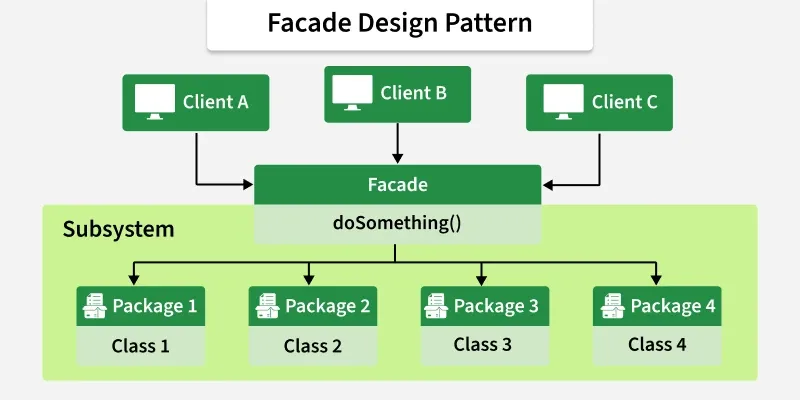
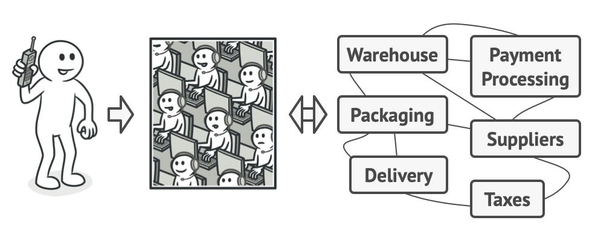
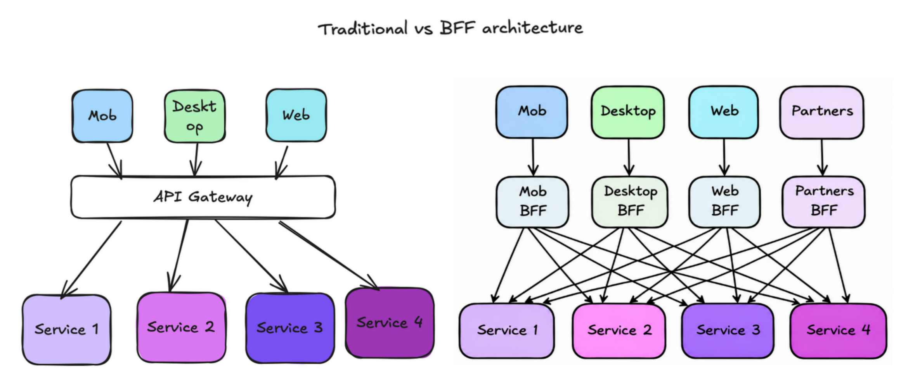

## Facade

1. [Углубленно про Facade](https://refactoring.guru/design-patterns/facade)

Фасад — структурный паттерн, который предоставляет простой интерфейс к сложной подсистеме (классу, набору классов, модулю, группе сервисов). Клиент работает с одним «входом», не зная, что внутри.

## Пример

В микросервисной архитектуре одна бизнес-операция часто требует данных из нескольких сервисов. Если клиент будет ходить в каждый напрямую, получится:
* много сетевых запросов;
* клиент знает внутреннюю структуру системы (плохо для поддержки);
* дублирование логики агрегации в каждом клиенте (мобильный, веб, партнёрский API);
* сложности с авторизацией, кэшированием, ретраями.

Фасад берёт всё это на себя.

Как фасад здания, который скрывает что находится внутри:

Оформление заказов по телефону:

## Плюсы/Минусы

\+ Вы можете изолировать свой код от сложности подсистемы.

\+ Позволяет менять внутренности подсистемы, не трогая клиентов

\- «Фасад» может превратиться в «божественный объект» (god object), который оказывается связанным со всеми классами приложения.

\- Дополнительный слой = дополнительная точка отказа / latency

## Частный случай BFF (Backend for Frontend) 

BFF — это архитектурный паттерн на уровне сервисов, а фасад — паттерн проектирования на уровне кода

### Api Gateway vs BFF

В отличие от API Gateway, который просто перенаправляет запросы, BFF **трансформирует данные**.

**API Gateway** — общая точка входа для всех клиентов, решает кросс-задачные вещи: аутентификация, rate limiting, маршрутизация, логирование.

**BFF** — отдельный фасад (бэк) под конкретный клиент (web / mobile / partner), решает задачи агрегации и адаптации данных под этот клиент.

Они не взаимоисключающие: BFF часто стоит за API Gateway.

### Когда выбирать bff?

1) Разные АПИ для разных каналов web/мобилка
Если ловите себя на мысли: «этот эндпоинт нужен только для веба» или «мобилка использует 10% полей из ответа», — пора задуматься о BFF.

2) Классическая проблема: дизайнеры придумали новый дизайн
Способ отображения товаров в каталоге изменился. Теперь нужны дополнительные поля, другая группировка, новые фильтры.

Без BFF это означает изменения в основном API, которые могут сломать другие клиенты. С BFF — правки только в одном месте.