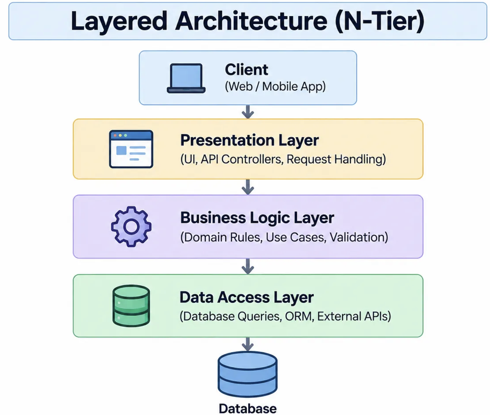
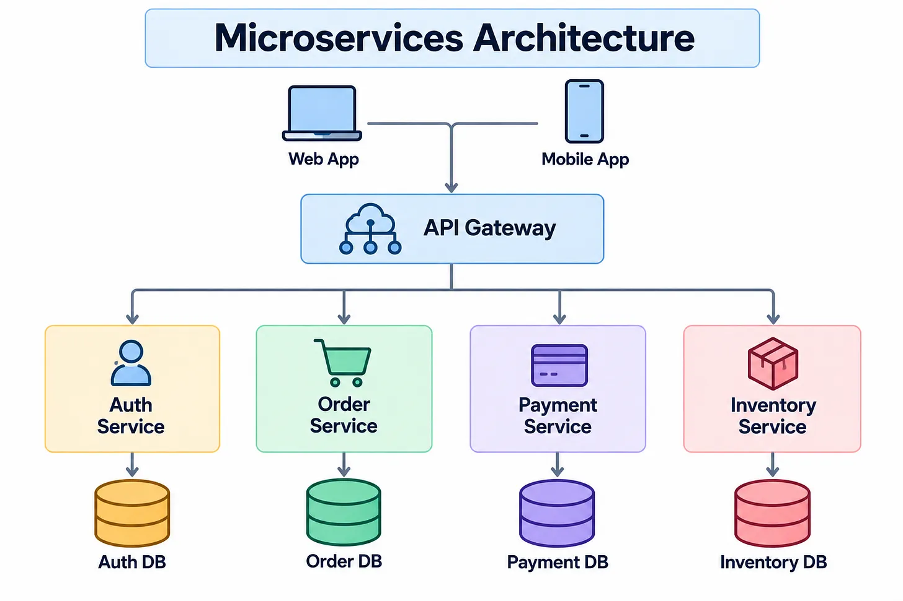
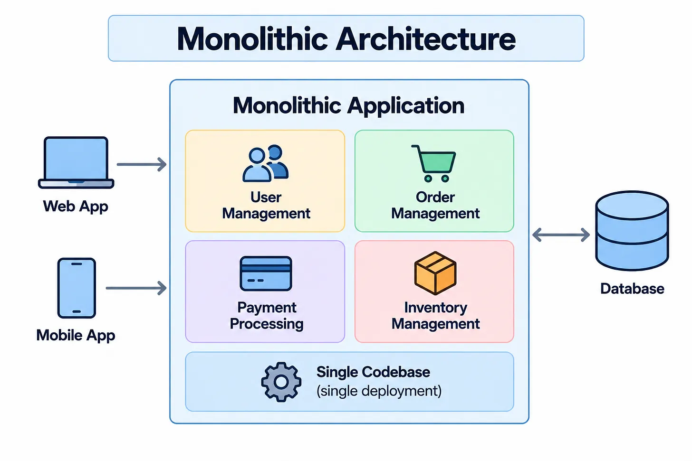
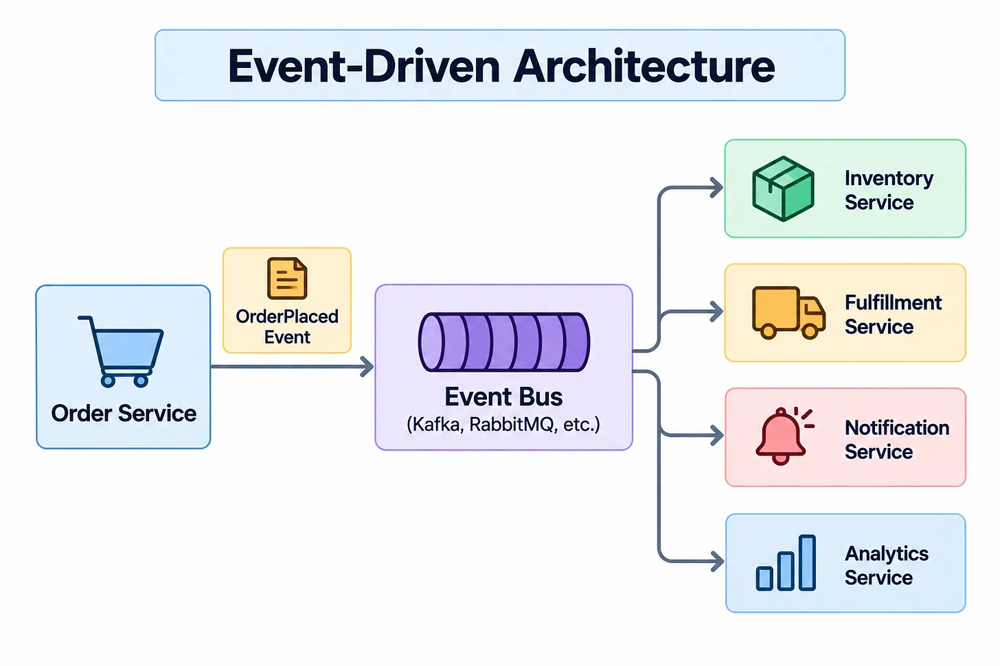
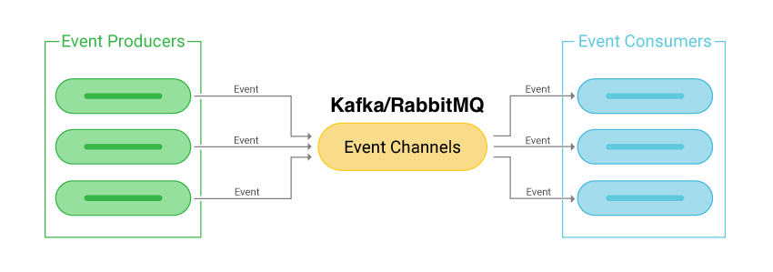

## Event-Driven Architecture (Cобытийно-ориентированная архитектура)

Событийно-ориентированная архитектура/Event-Driven Architecture (EDA) — это подход, при котором компоненты системы обмениваются не прямыми синхронными вызовами, а событиями — сигналами об изменении состояния.

| Слоистая | Микросервисы | Монолит | Событийная |
|:---:|:---:|:---:|:---:|
|  |  |  |  |`

### Принципы событийной архитектуры и её компоненты

У Event-Driven-архитектуры есть несколько базовых компонентов.
* События (Events): это ключевые изменения или важные действия в системе. Например, "пользователь зарегистрировался" или "оплата подтверждена".
* Producer (Писатель) — источник события. Это может быть сервис заказов, платёжный модуль, мобильное приложение, IoT-устройство или любой другой компонент, который фиксирует изменение состояния;
* Транспортный слой — брокер, шина, маршрутизатор или потоковая платформа, которая принимает событие и передаёт его дальше. Н/р: [Kafka](./4.5.3%20ApacheKafka.md) или [RabbitMQ](./4.5.4%20RabbitMQ.md) или [WebSockets](/2%20ComputerScience/2.3%20Networking/2.3.2%20Web/2.3.2.6%20WebSocket.md) / Webhooks;
* Consumer (Читатель) — сервис, который получает событие и реагирует на него.

## Отличия от традиционной REST архитектуры

Традиционная архитектура, н/р: [REST API](/2%20ComputerScience/2.3%20Networking/2.3.1%20API/2.3.1.2%20RestAPI.md), — это как телефонный звонок: клиент звонит серверу, сервер отвечает. 

Но что, если сервер занят? Вам придётся ждать. В EDA этот процесс асинхронный: клиент "кричит" свою просьбу в общий микрофон (топик Kafka), и кто-то обязательно это услышит.

Можно выделить несколько ключевых отличий EDA:

* Асинхронность: события создаются и обрабатываются независимо друг от друга;
* Слабая связанность: компоненты не зависят от прямого вызова друг друга;
* Реактивность: каждый компонент реагирует на поступающие события.

## EDA vs REST/Асинхронный подход vs Синхронный — разница

Асинхронный подход против Синхронного
EDA по своей сути асинхронен, что делает его подходящим для сценариев, в которых обмен данными не требует немедленного ответа. REST, будучи синхронным, подходит, когда необходим немедленный результат.

Масштабируемость: EDA обеспечивает лучшую масштабируемость, поскольку может обрабатывать пропускную способность с минимальным воздействием на производительность. При высокой нагрузке REST может столкнуться с узкими местами, если не управлять им должным образом.

Надежность: EDA обеспечивает высокую доступность и долговечность данных за счет репликации. REST зависит от реализации HTTP‑сервера и базовой инфраструктуры.

| Функция | EDA | REST |
|---|---|---|
| Стиль взаимодействия | асинхронный | синхронный |
| Формат данных | любой (JSON, Avro, Protobuf); схемы опционально (Schema Registry) | JSON, XML и так далее |
| Производительность и масштабируемость | Высокая пропускная способность и масштабируемость | Зависят от масштабируемости HTTP-сервера |
| Надежность | Высокая | Различная |
| Подходящие варианты использования | Архитектуры, управляемые событиями | Взаимодействия запрос-ответ |

# TBD

inbox/outbox
Паттерны проектирования в Event-driven архитектуре

-------

[4.5 Message Brokers Theme Finder](/4%20Linkage/4.5%20MessageBrokers/) | [Back To iTWiki Contents](https://github.com/eldaroid/iTWiki) | [4.5.2 Message Brokers Theme](/4%20Linkage/4.5%20MessageBrokers/4.5.2%20MessageBrokers.md) 