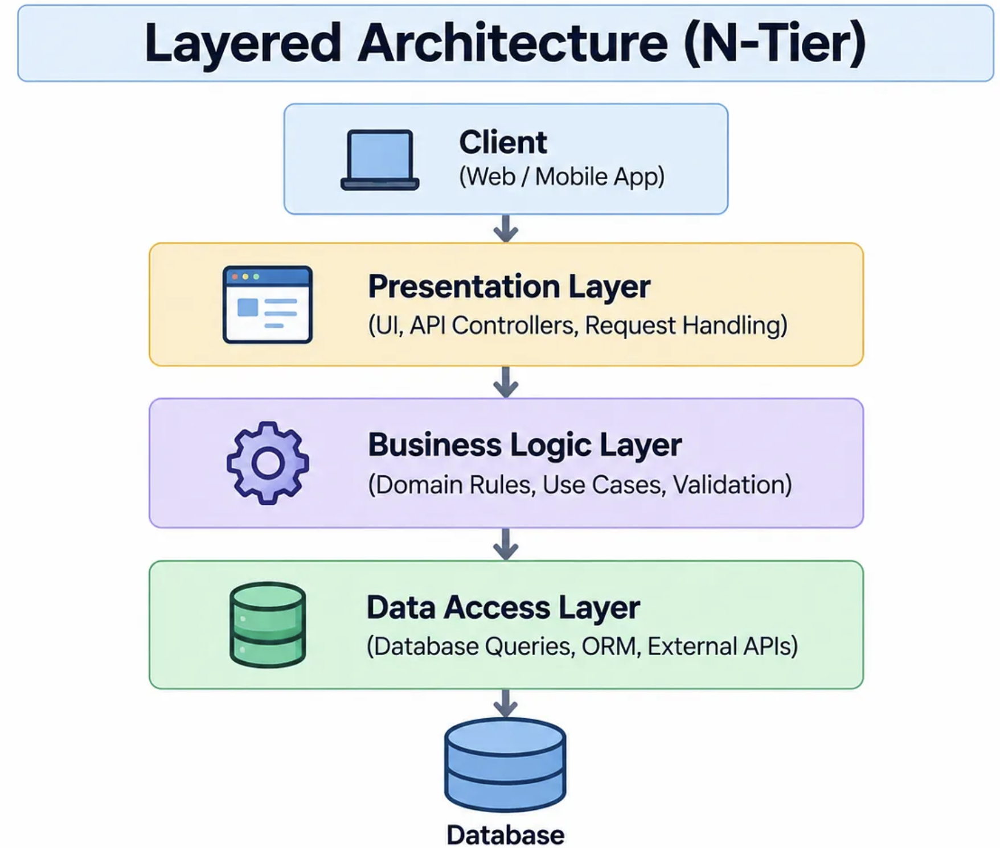
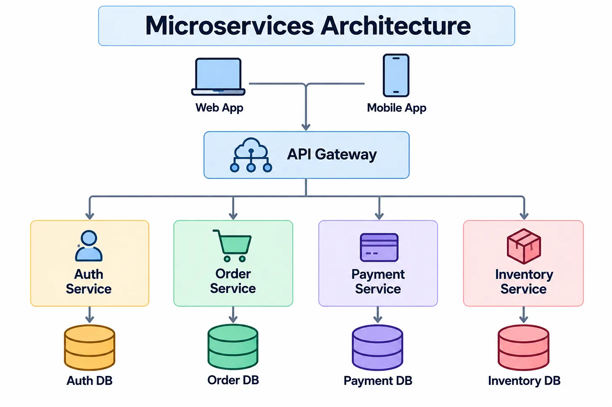
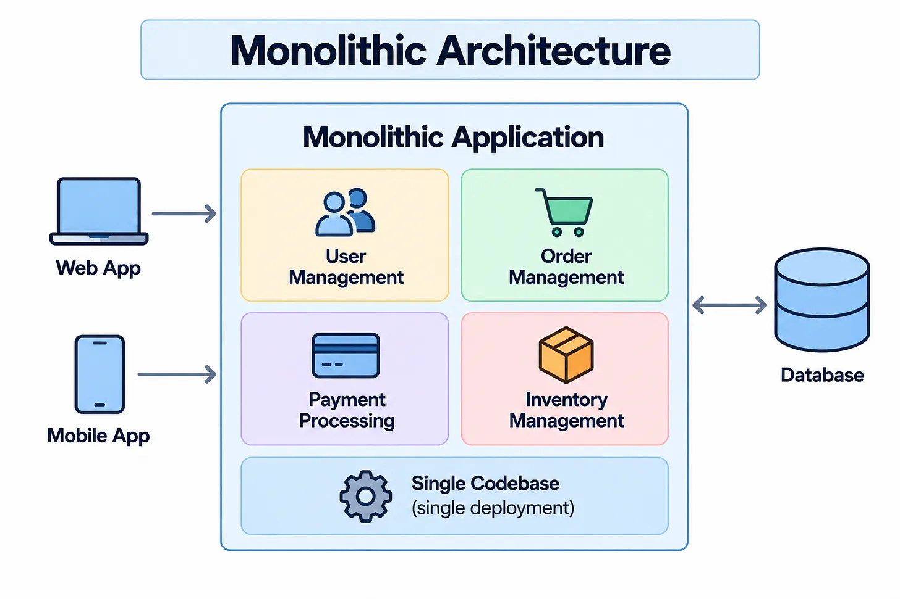
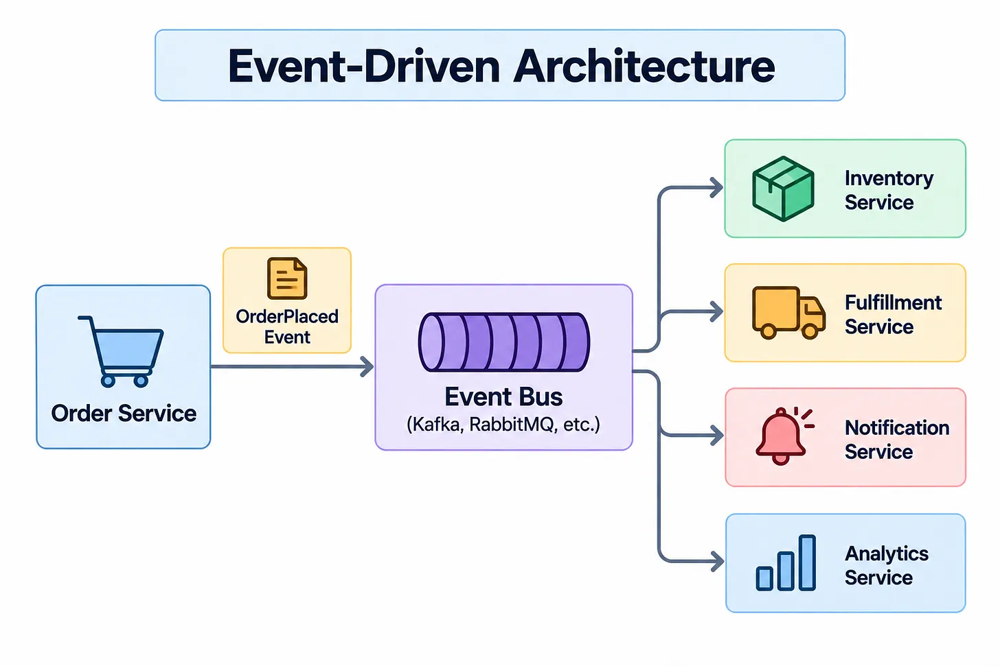

## Event-Driven Architecture (Cобытийно-ориентированная архитектура)

Событийно-ориентированная архитектура, или Event-Driven Architecture (EDA), — это подход, при котором компоненты системы обмениваются не прямыми синхронными вызовами, а событиями — сигналами об изменении состояния.

| Слоистая | Микросервисы | Монолит | Событийная |
|:---:|:---:|:---:|:---:|
|  |  |  |  |

### Принципы событийной архитектуры и её компоненты

У Event-Driven-архитектуры есть несколько базовых компонентов.

* Producer — источник события. Это может быть сервис заказов, платёжный модуль, мобильное приложение, IoT-устройство или любой другой компонент, который фиксирует изменение состояния;
* Транспортный слой — брокер, шина, маршрутизатор или потоковая платформа, которая принимает событие и передаёт его дальше;
* Consumer — сервис, который получает событие и реагирует на него.

