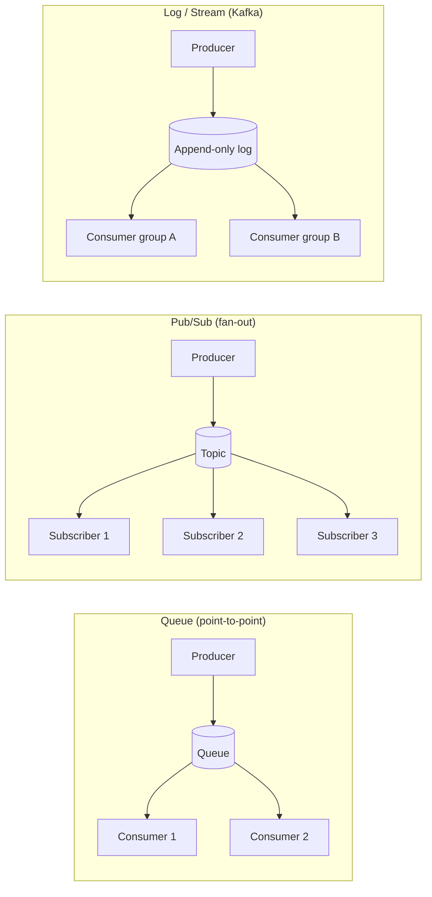

# Message Brokers

> **TL;DR** — Message broker (брокер сообщений) — это промежуточный слой,
> который принимает сообщения от **producer**'ов, хранит их и отдаёт
> **consumer**'ам. Развязывает сервисы по времени, пространству и скорости.

## Что это и зачем?

Брокер сообщений решает три проблемы, которые возникают, как только
сервисов становится больше одного:

| Проблема | Без брокера | С брокером |
|---|---|---|
| **Связанность (coupling)** | Сервис A знает адрес сервиса B | A пишет в топик, B читает из топика |
| **Доступность** | B упал → A тоже падает/теряет данные | B упал → сообщения ждут в брокере |
| **Пики нагрузки** | A захлёбывает B | Сообщения буферизуются, B разгребает в своём темпе |

Формально брокер даёт **асинхронность** и **decoupling**:
- **Пространственный decoupling** — producer не знает, кто consumer.
- **Временной decoupling** — producer и consumer не работают одновременно.
- **Скоростной decoupling** — producer и consumer работают с разной скоростью.

## Терминология

- **Producer** — тот, кто публикует сообщения.
- **Consumer** — тот, кто читает сообщения.
- **Topic / Queue / Stream** — логический канал, куда пишут и откуда читают.
  - В **queue**-модели сообщение достаётся **одному** consumer'у (work queue).
  - В **pub/sub**-модели сообщение получают **все** подписчики.
  - В **log/stream**-модели (Kafka) сообщения **хранятся** и перечитываются.
- **Partition / Shard** — способ распараллелить топик.
- **Offset** — позиция сообщения в логе (Kafka).
- **Consumer group** — группа consumer'ов, делящих партиции между собой.
- **Broker** — сам сервер/процесс, хранящий топики.
- **Cluster** — несколько брокеров с репликацией.
- **Ack (acknowledgement)** — подтверждение доставки/обработки.

## Модели доставки

## Kafka vs REST — разница

Асинхронный подход против Синхронного: Kafka по своей сути асинхронен, что делает его подходящим для сценариев, в которых обмен данными не требует немедленного ответа. REST, будучи синхронным, подходит, когда необходим немедленный результат.

Масштабируемость: Kafka обеспечивает лучшую масштабируемость, поскольку может обрабатывать пропускную способность с минимальным воздействием на производительность. При высокой нагрузке REST может столкнуться с узкими местами, если не управлять им должным образом.

Надежность: Kafka обеспечивает высокую доступность и долговечность данных за счет репликации. REST зависит от реализации HTTP‑сервера и базовой инфраструктуры.

| Функция | Kafka | REST |
|---|---|---|
| Стиль взаимодействия | асинхронный | синхронный |
| Формат данных | любой (JSON, Avro, Protobuf); схемы опционально (Schema Registry) | JSON, XML и так далее |
| Производительность и масштабируемость | Высокая пропускная способность и масштабируемость | Зависят от масштабируемости HTTP-сервера |
| Надежность | Высокая | Различная |
| Подходящие варианты использования | Архитектуры, управляемые событиями | Взаимодействия запрос-ответ |

