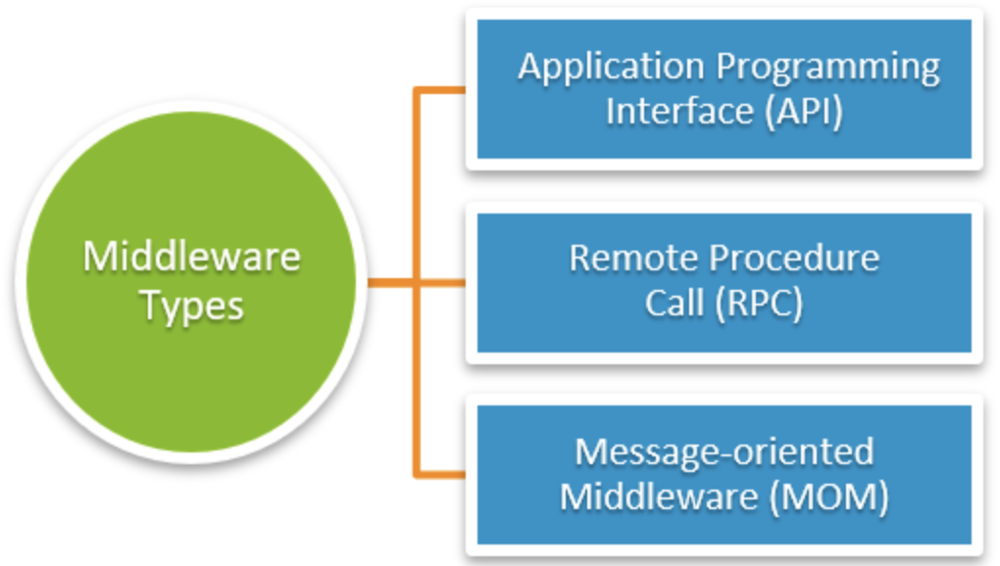

# Middleware - Промежуточное ПО

* [API](/4%20Linkage/4.5%20Middleware/4.5.2%20API/) - это интерфейс (совокупность способов, средств, правил и возможностей взаимодействия кого-либо или чего-либо с кем-либо или чем-либо);
* [Message-oriented middleware](/4%20Linkage/4.5%20Middleware/4.5.3%20EventDrivenArchitecture/) - промежуточный слой ПО, который обеспечивает взаимодействие между компонентами системы при помощи сообщений;
* [RPC](/4%20Linkage/4.5%20Middleware/4.5.4%20RPC/)
