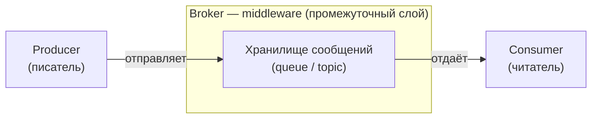
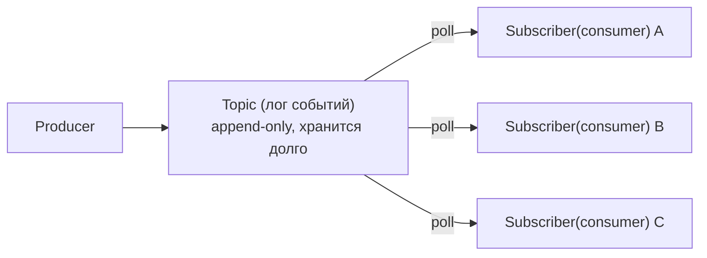
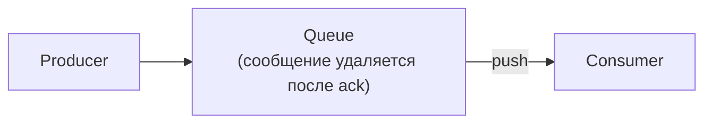
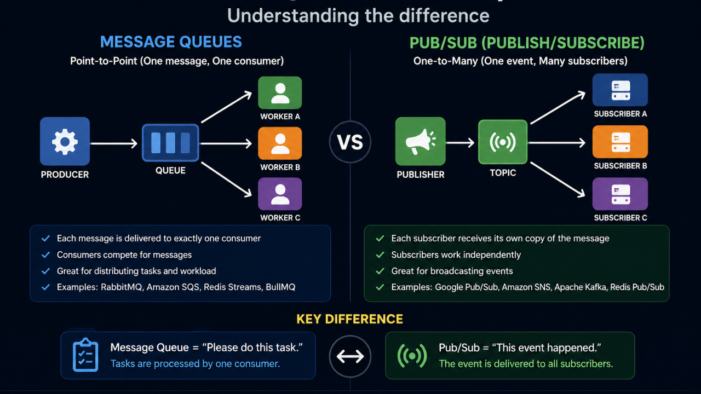

# Message Oriented Middleware (MOM) - Brokers as Middlewares

> Broker — это промежуточный слой ([middleware](/4%20Linkage/4.5%20Middleware/)),
> который принимает сообщения от **producer**'ов, хранит их и отдаёт **consumer**'ам.

## Что это и зачем?

Брокер сообщений решает три проблемы, которые возникают, как только
сервисов становится больше одного:

| Проблема | Без брокера | С брокером |
|---|---|---|
| **Связанность (coupling)** | Сервис A знает адрес сервиса B | A пишет в топик, B читает из топика |
| **Доступность** | B упал → A тоже падает/теряет данные | B упал → сообщения ждут в брокере |
| **Пики нагрузки** | A захлёбывает B | Сообщения буферизуются, B разгребает в своём темпе |

## Терминология

- **Producer** — тот, кто публикует сообщения (писатель).
- **Consumer или subscriber** — тот, кто читает сообщения.
- **Topic / Queue / Stream** — логический канал, куда пишут и откуда читают.
  - В **queue**-модели сообщение достаётся **одному** consumer'у (work queue).
  - В **pub/sub**-модели сообщение получают **все** подписчики.
  - В **log/stream**-модели (Kafka) сообщения **хранятся** и перечитываются.
- **Partition / Shard** — это стособ параллелизма, порядка и хранения в Kafka. 
    Несколько партиций дают параллелизм (каждая читается своим consumer'ом в группе); 
    Внутри одной партиции Kafka гарантирует порядок сообщений (append-only лог); 
    Партиции распределяются по брокерам и реплицируются, обеспечивая масштабирование Хранения и отказоустойчивость. Увеличить партиции можно, уменьшить - нет.
    - **Offset** — порядковый номер  (позиция) сообщения в логе.
- **Consumer group** — группа consumer'ов, делящих партиции между собой.
- **Broker** — сам сервер/процесс на котором запущена [Kafka](./4.5.3.2%20ApacheKafka.md) или [RabbitMQ](./4.5.3.3%20RabbitMQ.md), хранящий топики.
- **Cluster** — несколько брокеров с репликацией.
- **Ack (acknowledgement)** — подтверждение доставки/обработки.

## Event Broker (kafka) vs Message Broker (rabbitMQ)

**Event broker (Kafka)**: хранит последовательность неизменяемых событий в логе (топике), события хранятся днями/неделями и не удаляются после consumption; подходит для работы с текущими и историческими событиями в больших объемах.

**Message broker (RabbitMQ)**: передает сообщения от продюсера к консьюмеру асинхронно, сообщения живут в очереди недолго и удаляются после успешной обработки; порядок обработки не гарантируется; подходит для короткоживущих команд/задач.

## Сообщения в middlewares

> Messages = Events = Record = Data

Kafka и RabbitMQ не парсят содержимое сообщений — для них payload это непрозрачный набор байт. Брокер лишь хранит и доставляет эти байты (плюс метаданные: key, headers, content-type, offset и т.п.). 

Формат данных — JSON, Avro, Protobuf, текст или бинарь — определяется serializer/deserializer (SerDe) на стороне продюсера и консьюмера, то есть это контракт между приложениями, а не свойство брокера. Именно поэтому вопросы совместимости и эволюции формата решаются на уровне приложения (например, через Schema Registry), а не силами самого middleware.

## Модели доставки сообщений

**Point-to-point** и **pub-sub** — это не свойства брокера, а свойства конфигурации поверх носителя: очереди в RabbitMQ или лога в Kafka. Оба брокера умеют обе модели. Разница в том, какая модель родная, а какая эмулируется — и во что обходится эмуляция: копирование против чтения лога, размер очередей против retention, биндинги против назначения партиций.

**Point-to-point (p2p, 1-->1)** - сообщение попадает в очередь, откуда его забирает ровно один потребитель. Несколько потребителей на одной очереди конкурируют за сообщения (паттерн competing consumers) — это способ масштабировать обработку, а не разослать копии.

> сообщения одному

**Publish-subscribe (pub-sub, 1-->Many)** - сообщение попадает в топик, и его получают все подписчики независимо друг от друга. Каждый подписчик видит полный поток.

> чтение общего лога

### Как именно достигается независимость подписчиков — копированием сообщения каждому или чтением общего лога? 

От ответа зависят retention, порядок, масштабирование и стоимость.

### RabbitMQ
**Point-to-point** — *«родная»* модель для RabbitMQ: queue + competing consumers, сообщение достаётся одному. Это базовый режим.

**Publish-subscribe** — тоже есть, через fanout exchange: exchange раскладывает копию сообщения в отдельную очередь на каждого подписчика. То есть pub-sub строится поверх очередей (с копированием).

Плюс routing (direct/topic/headers) — гибкая маршрутизация.

### Kafka
**Publish-subscribe** — *«родная»* модель для Kafka: topic + несколько consumer groups, каждая группа читает весь лог независимо (без копирования данных).

**Point-to-point** — тоже есть, внутри consumer group: партиции делятся между consumer'ами группы, и каждое сообщение партиции достаётся ровно одному consumer'у внутри группы. То есть p2p — это частный случай внутри группы, а pub-sub — между группами."

## Модели доставки по гарантиям доставки

