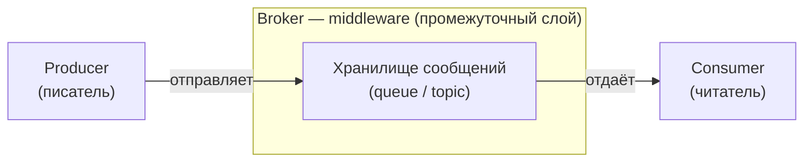
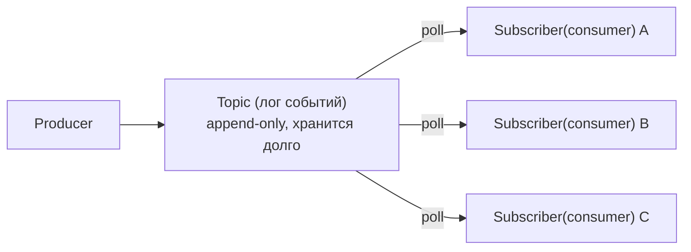
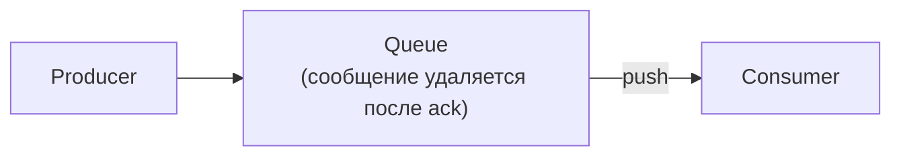
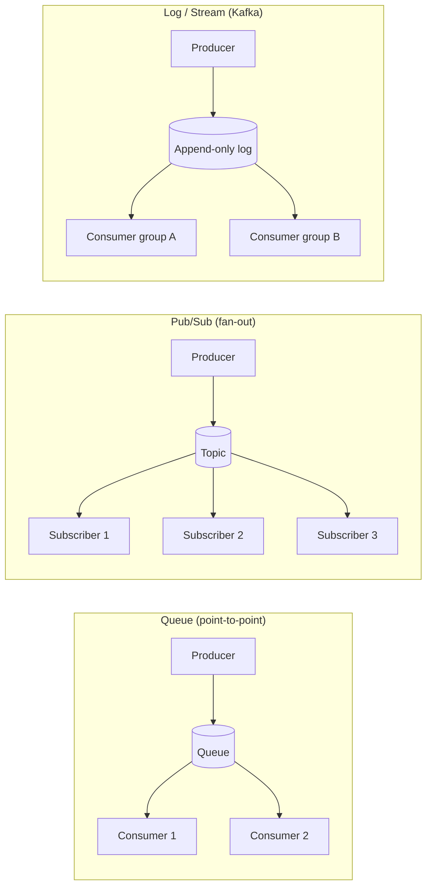

# Message Oriented Middleware (MOM) - Brokers as Middlewares

> Broker — это промежуточный слой ([middleware](/4%20Linkage/4.5%20Middleware/)),
> который принимает сообщения от **producer**'ов, хранит их и отдаёт **consumer**'ам.

## Что это и зачем?

Брокер сообщений решает три проблемы, которые возникают, как только
сервисов становится больше одного:

| Проблема | Без брокера | С брокером |
|---|---|---|
| **Связанность (coupling)** | Сервис A знает адрес сервиса B | A пишет в топик, B читает из топика |
| **Доступность** | B упал → A тоже падает/теряет данные | B упал → сообщения ждут в брокере |
| **Пики нагрузки** | A захлёбывает B | Сообщения буферизуются, B разгребает в своём темпе |

## Терминология

- **Producer** — тот, кто публикует сообщения (писатель).
- **Consumer или subscriber** — тот, кто читает сообщения.
- **Topic / Queue / Stream** — логический канал, куда пишут и откуда читают.
  - В **queue**-модели сообщение достаётся **одному** consumer'у (work queue).
  - В **pub/sub**-модели сообщение получают **все** подписчики.
  - В **log/stream**-модели (Kafka) сообщения **хранятся** и перечитываются.
- **Partition / Shard** — это стособ параллелизма, порядка и хранения в Kafka. Несколько партиций дают параллелизм (каждая читается своим consumer'ом в группе); внутри одной партиции Kafka гарантирует порядок сообщений (append-only лог); партиции распределяются по брокерам и реплицируются, обеспечивая масштабирование хранения и отказоустойчивость. Увеличить партиции можно, уменьшить - нет.
    - **Offset** — порядковый номер  (позиция) сообщения в логе.
- **Consumer group** — группа consumer'ов, делящих партиции между собой.
- **Broker** — сам сервер/процесс на котором запущена [Kafka](./4.5.3.2%20ApacheKafka.md) или [RabbitMQ](./4.5.3.3%20RabbitMQ.md), хранящий топики.
- **Cluster** — несколько брокеров с репликацией.
- **Ack (acknowledgement)** — подтверждение доставки/обработки.

## Event Broker (kafka) and Message Broker (rabbitMQ)

**Event broker (Kafka)**: хранит последовательность неизменяемых событий в логе (топике), события хранятся днями/неделями и не удаляются после consumption; подходит для работы с текущими и историческими событиями в больших объемах.

**Message broker (RabbitMQ)**: передает сообщения от продюсера к консьюмеру асинхронно, сообщения живут в очереди недолго и удаляются после успешной обработки; порядок обработки не гарантируется; подходит для короткоживущих команд/задач.

## Модели доставки сколько получателей получат сообщение

Publish / Subscribe, или «публикация-подписка»?

Point-to-Point, или «точка-точка»?

## Модели доставки по гарантиям доставки

