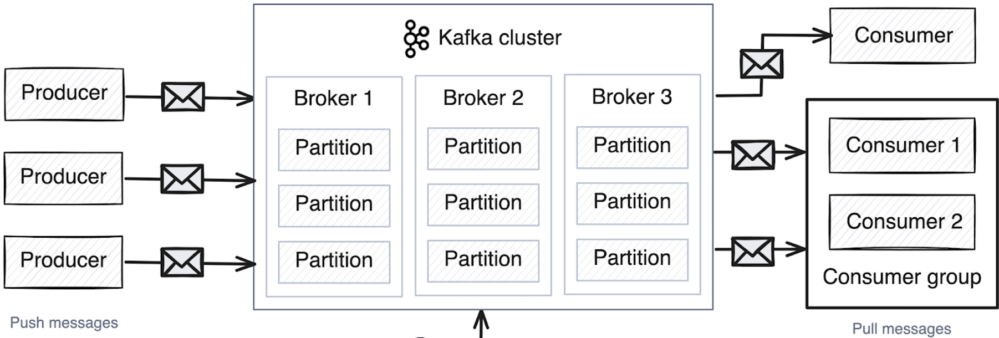

# Apache Kafka как брокер сообщений

[Сайт Apache Kafka](https://kafka.apache.org/intro/) + [github](https://github.com/apache/kafka)

Apache Kafka — это брокер сообщений, который помогает передавать события от "главного героя" к "зрителям". Kafka делает обработку быстрее, изолируя тяжёлые задачи и обеспечивая высокую надёжность.

# Чтение в Kafka

У топика может быть сколько угодно consumer group.
Каждая из consumer group получит все сообщения из всех партиций топика
Внутри одной consumer group поделят партиции между собой, но разные группы получат все партиции

## Сообщение в Kafka

## Модели доставки по подтверждению (acknowledgment)

Acknowledgment (Kafka acks) "подтверждения" - параметр конфигурации продюссера о подтверждении что запись(сообщение) получена.

* acks = 0 - выстрелил и забыл. Подходит для метрик/логов/неважных данных
* acks = 1 - продюссер ждет подтверждения от мастера (не ждет от слейвов)
* acks = all (-1) - продюссер ждет подтверждения от мастера и всех слейвово. Необходимо для: фин. услуг или банковских операций

В Kafka продюсер пишет в топик, а партицию выбирает брокер (по key или round-robin).?

# Kafka vs RabbitMQ

Прежде чем сравнивать, зафиксируем главное: Kafka и RabbitMQ решают одну задачу (передать сообщение от A к B), но построены вокруг разных идей. 

Kafka — это **лог**, в который пишут и из которого читают. 

RabbitMQ — это **брокер**, который решает, кому и как доставить сообщение.

---

## Сводная таблица

| Критерий | Kafka | RabbitMQ |
|---|---|---|
| Модель | Распределённый лог | Брокер очередей + exchanges |
| Порядок | Внутри партиции | Внутри очереди (при 1 consumer) |
| Маршрутизация | Топик + ключ → партиция | direct / topic / fanout / headers |
| Доставка | Pull | Push |
| После чтения | Живёт по retention | Удаляется после ack |
| Replay | Да, сбросом offset | Нет |
| Параллелизм | ≤ число партиций в группе | Много consumer'ов на очередь |
| Приоритеты / TTL / delayed | Нет из коробки | Есть |
| Exactly-once | Да (в пределах Kafka) | Нет first-class |
| История | Долгая (дни/недели/compaction) | Пока не прочитано |
| Протоколы | Свой бинарный | AMQP, MQTT, STOMP |

---

## Что выбрать — по сценарию

**Kafka**, когда сообщение — это **данные**:

- event sourcing, журнал событий как источник истины;
- несколько независимых потребителей одного потока (fan-out с replay);
- CDC (Debezium + Kafka Connect), интеграция данных;
- stream processing (Kafka Streams, ksqlDB, Flink);
- высокая нагрузка, нужна durability и горизонтальный масштаб;
- аналитика по историческим событиям.

**RabbitMQ**, когда сообщение — это **задача**:

- task queues, распределение работы между воркерами;
- сложная маршрутизация (topic/direct/fanout/headers, bindings);
- приоритеты, per-message TTL, отложенная доставка, DLQ;
- RPC / request-reply;
- IoT/MQTT, умеренные нагрузки, важна простота.

**Ни то, ни другое**, если очередь простая и нагрузка низкая — SQS или Redis Streams будут дешевле в эксплуатации.

---

## Частые ошибки в выборе

- **«Kafka быстрее»** — на throughput да, на latency одного сообщения RabbitMQ часто лучше.
- **«RabbitMQ не масштабируется»** — масштабируется через очереди и consumer'ов; quorum queues дают репликацию.
- **«Kafka — это очередь»** — это лог; очередь — один из паттернов поверх него.
- **«В RabbitMQ нет порядка»** — есть, пока consumer один; с несколькими порядок теряется по определению.
- **«В RabbitMQ есть exactly-once»** — нет; достигается идемпотентностью приложения.

---

## Короткое правило

Спросите себя: 
* **«мне нужно перечитывать историю и обрабатывать её многими способами?»** — Kafka. 
* **«мне нужно прямо сейчас доставить задачу нужному исполнителю?»** — RabbitMQ.
